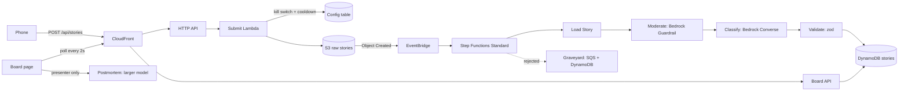

# Tech Horror Stories

A live, crowd-sourced AI pipeline built for a conference talk. The audience scanned a QR code, typed their worst production incident into their phone in 280 characters, and watched it move through a serverless AWS pipeline onto a board on the projector: moderated, classified by an LLM, scored for fear, and occasionally buried in the Graveyard with a deadpan quip.

This repo is the whole thing, infrastructure included. You can read it to see how the pieces fit, or deploy your own copy and run the demo yourself.

**The point of the talk:** you don't need a data platform to build an AI-powered pipeline. A few Lambdas, a Step Functions state machine, and Bedrock get you surprisingly far, and everything is pay-per-use, so nothing runs (or costs anything) when nobody is using it.



## What happens to a story

1. **Submit.** The phone posts the story. A Lambda checks the kill switch and a 20 second per-device cooldown, then drops the text in S3.
2. **Start a workflow.** The S3 upload fires an EventBridge event, which starts one Step Functions execution per story. Each one is a visual trace you can open in the console.
3. **Clean up.** `Load Story` normalizes the text (look-alike characters, invisible characters, s p a c e d - o u t letters) so filter-evasion tricks stop working, and catches empty stories, gibberish, short heckles, and heavy swearing.
4. **Moderate.** A Bedrock Guardrail blocks hate, threats, prompt attacks, and personal data, and masks names, links, and secrets (`[name]`, `[link]`, `[token]`) before the model ever sees them.
5. **Classify.** Claude Haiku 4.5 reads the story and returns JSON: a headline, a category, a fear level, a root cause, and whether it is a story at all.
6. **Validate.** A strict zod schema checks the model's output. If it fails, Step Functions retries the model call natively.
7. **Check the output.** The model's own words go back through the same Guardrail before anything reaches the screen.
8. **Publish or bury.** Good stories land on the board. Everything else lands in the Graveyard with the reason it failed and a fixed, canned quip.

On stage, the presenter can also ask a larger model (Claude Sonnet 4.6) to write a blameless postmortem for the scariest story. That runs asynchronously, because it can take longer than an HTTP API allows.

## Why not an agent?

No AgentCore, no Strands, no agent loop. Every story takes the same known path, and the model is called once per story with no tools, so a Step Functions workflow fits better than an agent: hostile audience input can't steer it, the moderation steps can't be skipped, every failure has a named path, and the cost per story is predictable. [Architecture](docs/architecture.md#why-not-an-agent-agentcore-strands-bedrock-agents-langgraph) has the full reasoning, and when an agent would be the right call.

## A tour of the code

| If you want to see... | Look at |
|---|---|
| The workflow, including retries, catches, and the Graveyard | [lib/state-machine.ts](lib/state-machine.ts) |
| How story text is kept out of the instructions (prompt injection defence) | [src/shared/prompt.ts](src/shared/prompt.ts) |
| The schema that model output must pass | [src/shared/schema.ts](src/shared/schema.ts) |
| Calling Bedrock with the Converse API, and tracking token cost | [src/shared/bedrock.ts](src/shared/bedrock.ts), [src/shared/cost.ts](src/shared/cost.ts) |
| Guardrail policies: blocked topics, masked data, custom regexes | [lib/pipeline-stack.ts](lib/pipeline-stack.ts), [src/shared/guardrail.ts](src/shared/guardrail.ts) |
| Defeating `ｆ𝐮ｃｋ`-style filter evasion | [src/shared/normalize.ts](src/shared/normalize.ts), [src/shared/censor.ts](src/shared/censor.ts) |
| Least-privilege IAM for cross-region inference profiles | [lib/bedrock-iam.ts](lib/bedrock-iam.ts) |
| One Lambda construct with logging, ARM, and an error alarm built in | [lib/constructs/monitored-function.ts](lib/constructs/monitored-function.ts) |
| Testing the real state machine locally, with Bedrock mocked | [test/state-machine.test.ts](test/state-machine.test.ts), [test/support/asl-runner.ts](test/support/asl-runner.ts) |
| The board (plain HTML, CSS, and JS; no framework) | [web/](web/) |

## Run your own

You need Node 22, the AWS CLI signed in to an account, and Bedrock access to Anthropic models in your region. The [deploying guide](docs/deploying.md) covers the details, including a couple of first-time-account traps (model quotas and the Marketplace subscription).

```bash
npm install
npm test               # unit tests + the state machine run locally against mocked Bedrock
npm run deploy         # three CDK stacks; prints the submit and board URLs
npm run seed           # 22 sample stories through the real API, good and bad
npm run teardown       # delete everything when you're done
```

A session with 60 people submitting three stories each costs well under $1, and the board shows the live model cost as it happens. See [Cost](docs/deploying.md#cost) for the breakdown.

## Docs

- [Architecture](docs/architecture.md): the three stacks, the state machine, and the design decisions behind them.
- [Moderation and security](docs/moderation-and-security.md): what the Guardrail blocks or masks, profanity handling, prompt injection, rate limits, and privacy.
- [Deploying](docs/deploying.md): prerequisites, configuration, every npm script, and cost.
- [Presenting](docs/presenting.md): running this as a live demo. The local admin page, the run sheet, and what to do when something breaks on stage.
