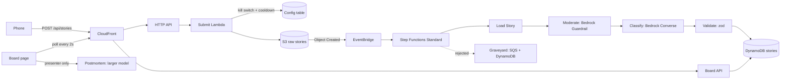

# Tech Horror Stories

This is for a live conference demo. Audience members scan a QR code, submit a short tech horror story from their phone, and watch it flow through a serverless AWS pipeline onto a live board on the projector. 

**What's the point?** You don't need a data platform to build an AI-powered pipeline.



Everything is serverless and pay-per-use. Nothing runs when nobody is using it.

## Stacks

| Stack | What is in it | Changes when |
|---|---|---|
| `TechHorrorIngestion` | Submit HTTP API (throttled), submit Lambda, raw story bucket (EventBridge on, 1 day expiry), config table (kill switch, cooldowns), alert SNS topic, $5 AWS Budget | Rarely |
| `TechHorrorPipeline` | Standard state machine, Load/Moderate/Classify/Validate Lambdas, Bedrock Guardrail, stories table, Graveyard SQS queue, the EventBridge rule | When tuning the AI steps |
| `TechHorrorBoard` | CloudFront + S3 for both pages, board read API, postmortem API and worker | When polishing the board |

Every Lambda uses one construct, `MonitoredFunction` ([lib/constructs/monitored-function.ts](lib/constructs/monitored-function.ts)): Node 22 on ARM, esbuild bundling, 1 week log retention, and an error alarm wired to the alert topic.

## The state machine

```
Load Story -> Is Story Usable? -> Moderate -> Passed Moderation? -> Apply Redactions -> Classify and Validate
                    |                                |                                  (Parallel: Classify -> Validate Output,
                    |                                |                                   Retry x2 on InvalidModelOutput)
                    |                                v                                          |
                    |                       Redact Blocked Story                                v
                    v                                |     Is It a Story? -> Moderate Output -> Output Passed? -> Publish to Board -> Published
             Send to Graveyard  <--------------------+---------------------- Reason: Output Blocked / Invalid Model Output / Pipeline Error
             (Queue for Review + Record in Graveyard) -> Rejected
```

- One execution per story (no Map state). Each one can be opened in the console during the talk.
- Every failure path ends in `Rejected`, a Succeed state. Bad input never fails an execution.
- `Classify and Validate` is a Parallel with one branch. That lets a single native Retry re-run both steps when the model returns something that fails the zod schema.
- `Load Story` normalizes text first (look-alike characters, invisible and direction-flipping characters, spaced-out letters) so filter-evasion tricks stop working.
- `Apply Redactions` swaps in the Guardrail's masked text, so names, links, and secrets become `[name]`, `[link]`, `[token]` before the model, the table, or the board see them.
- `Is It a Story?` sends heckles and chatter the classifier flagged (`is_story: false`) to the Graveyard.
- `Moderate Output` runs the model's headline and root cause back through the same Guardrail before publishing.
- Text that never passed moderation is blanked before it reaches the Graveyard. The board also hides moderated text in the API response.

## Prerequisites

1. Node 22 and the AWS CLI, signed in to the account you will present from (`aws sts get-caller-identity`).
2. CDK bootstrap in that account and region, once: `npx cdk bootstrap`.
3. **Bedrock model access** in the deploy region. By default both models are called through US cross-region inference profiles:
   - Classifier: `us.anthropic.claude-haiku-4-5-20251001-v1:0` (Claude Haiku 4.5)
   - Postmortem: `us.anthropic.claude-sonnet-4-6` (Claude Sonnet 4.6)

   If your account has never used Anthropic models on Bedrock, submit the one-time use case form in the Bedrock console first.

   **Check quotas, not just access.** A model can be listed as ACTIVE and still have a quota of 0. New accounts start with 0 tokens per minute for Claude 5.x models on Bedrock, which is why the postmortem defaults to Sonnet 4.6. New accounts also get only 10 concurrent Lambda executions; request 1,000 in Service Quotas (Lambda, "Concurrent executions") a few days before the talk. Haiku 4.5 allows 50 requests per minute by default; the pipeline retries patiently on throttling, so a burst arrives late rather than in the Graveyard.
   ```bash
   aws lambda get-account-settings --query AccountLimit.ConcurrentExecutions
   aws service-quotas list-service-quotas --service-code bedrock --query "Quotas[?contains(QuotaName,'Cross-region model inference')&&contains(QuotaName,'Claude')].[QuotaName,Value]" --output text
   ```

   Confirm the exact profile IDs your account sees:
   ```bash
   aws bedrock list-inference-profiles --query "inferenceProfileSummaries[?contains(inferenceProfileId,'anthropic')].inferenceProfileId"
   ```
4. Bedrock Guardrails must be available in the region (they are in us-east-1 and us-west-2).

## Configuration

Model IDs, the alert email, and the budget come from CDK context or environment variables (env wins):

| Setting | Context key | Env var | Default |
|---|---|---|---|
| Classifier model | `classifierModelId` | `CLASSIFIER_MODEL_ID` | Haiku 4.5 US profile |
| Postmortem model | `postmortemModelId` | `POSTMORTEM_MODEL_ID` | Sonnet 4.6 US profile |
| Alarm and budget email | `alertEmail` | `ALERT_EMAIL` | none (budget still alerts the SNS topic) |
| Monthly budget (USD) | `budgetUsd` | `BUDGET_USD` | 5 |

Example: `npm run deploy -- -c alertEmail=you@example.com -c postmortemModelId=us.anthropic.claude-opus-5-5`

Model prices live in [config/prices.ts](config/prices.ts). Update them if Bedrock pricing changes. A model without a price entry is counted as $0.

## Deploy, test, tear down

```bash
npm install
npm test                 # unit tests + the state machine run locally against mocked Bedrock
npm run synth            # cdk synth, all three stacks
npm run deploy           # cdk deploy --all, writes cdk-outputs.json for the scripts
npm run presenter-key    # creates the key and prints the presenter board URL
npm run qr               # QR codes in qr/
npm run seed             # 20 stories through the real API
npm run teardown         # after the talk
```

| Script | What it does |
|---|---|
| `npm run seed [-- --fast]` | Submits the 22 seed stories (15 good, two with a little swearing that the board censors; 2 empty or gibberish; 1 personal data; 1 heckle; 1 with too much swearing; 2 prompt injections) |
| `npm run qr` | `qr/submit-slide.{png,svg}` (1600px) and `qr/submit-corner.{png,svg}` (200px) for the submit URL |
| `npm run admin` | Local presenter page: bury or restore stories, open or close submissions |
| `npm run reset` | Empties the board: every story, Graveyard entry, cached postmortem, and the cost counter. Asks you to type `reset`. Infrastructure, presenter key, and kill switch are untouched |
| `npm run kill` | Submit endpoint returns 503 "Submissions closed" immediately |
| `npm run reopen` | Opens submissions again |
| `npm run presenter-key` | Rotates the presenter key in SSM and prints `board.html#key=...` |
| `npm run replay -- --record` | Saves the live board and cached postmortems to `replay/recording.json` |
| `npm run replay` | Offline board at `http://localhost:8080/board.html#key=replay` |
| `npm run teardown` | `cdk destroy --all`, deletes the presenter key and local outputs |

## Cost

**The counter on the board is real.** Every Bedrock call (Guardrail, classify including retries, and postmortem) adds the token or text-unit usage returned by Bedrock to a running total in DynamoDB, priced with [config/prices.ts](config/prices.ts).

Rough model cost for 60 people x 3 stories (180 stories):

| Item | Estimate |
|---|---|
| Guardrail (story and model output, 1 text unit each) | about $0.15 |
| Classify (about 650 input, 70 output tokens on Haiku 4.5) | about $0.18 |
| Postmortems (5 runs on Sonnet 4.6) | about $0.10 |
| **Total shown on the counter** | **about $0.50** |

**Not included in the counter:** Step Functions transitions, Lambda, API Gateway, DynamoDB, S3, EventBridge, SQS, CloudFront, CloudWatch. Rough figures for the same session:

| Service | Estimate |
|---|---|
| Step Functions Standard (about 10 transitions per story, 1,800 total; 4,000 per month are free) | $0 to $0.05 |
| Lambda, API Gateway, DynamoDB, S3, EventBridge, SQS, CloudFront (board polling every 2s for an hour is about 1,800 requests) | under $0.05 combined |
| CloudWatch alarms (9 alarms at $0.10 per month, prorated) | about $0.03 per day while deployed |

The whole talk should come in well under $1. Tear down afterwards so the alarms stop accruing. The $5 Budget alerts at 80% actual and 100% forecast.

## Moderation

Everything the audience writes and everything the model writes goes through a Bedrock Guardrail. Policies live in [lib/pipeline-stack.ts](lib/pipeline-stack.ts).

There are two guardrails. The main one makes block decisions and reviews model output. A second, masking-only guardrail replaces names, links, and secrets in audience stories. It exists because **Bedrock Guardrails only anonymize when `source` is `OUTPUT`**; on `INPUT` the mask rules are silently ignored, so the Moderate step runs the story through the masking guardrail as `OUTPUT`.

| What | Action | Where |
|---|---|---|
| Hate, sexual content, violence, insults (low), misconduct (low) | Block | Story and model output |
| Prompt attacks | Block | Story |
| Threats against a person or group | Block | Story and model output |
| Mocking an identifiable person by role, employer, appearance, or seat ("the guy in row 3") | Block | Story and model output |
| Accusing a named real company of negligence, insecurity, or law breaking | Block | Story and model output |
| Jokes about suicide or self-harm | Block | Model output only (an audience member venting is let through; the model may not joke about it) |
| Emails, phone numbers, addresses, card numbers, passwords, AWS keys | Block | Story and model output |
| Names, usernames, `@handles` | Mask as `[name]` | Story and model output |
| IP addresses, URLs, 12 digit account ids, GitHub/Slack/OpenAI tokens, JWTs, private key headers, `*.internal` style hosts | Mask as `[ip]`, `[link]`, `[account id]`, `[token]`, `[key]`, `[host]` | Story and model output |
| Heckles and chatter ("this is dumb", "boring", "test") | Graveyard as "Not a story", text hidden. Short ones (6 words or fewer) are caught by a free text check; longer ones by the classifier's `is_story` field | Load Story, Classify |
| Profanity | One or two words: allowed and censored on display (`f******`), including `sh1t`, `f*ck`, `f u c k`. Three or more: Graveyard (`PROFANITY_LIMIT` in [config/app-config.ts](config/app-config.ts)) | Load Story, board and postmortem APIs |
| Postmortems | Whole text reviewed; a blocked one shows "failed its own moderation review" | Postmortem worker |

Every Graveyard entry records what exactly failed (for example `content:PROMPT_ATTACK`, `topic:IdentifiablePerson`, `profanity`, `gibberish`) and the board shows a canned, deadpan quip for that cause, like "Ignore previous instructions? Ignored." or "Come on, we're professionals. Allegedly." The quips are fixed text in [src/shared/quips.ts](src/shared/quips.ts), never model-generated, and the same story always gets the same quip.

Anything that still slips through: bury it from the admin page (below).

**Tuning:** every filter sends some honest stories to the Graveyard. The company and identifiable-person topics are the most likely to over-block (for example "AWS had an outage"). After deploying, run `npm run seed` and check the Graveyard; loosen a topic by editing its definition and examples and redeploying `TechHorrorPipeline`. Guardrails are most accurate in English, French, and Spanish.

## Presenter admin (local only)

```bash
npm run admin          # prints http://127.0.0.1:8787/?t=<token>
```

A page that runs on your laptop only, using your own AWS credentials. There is no public admin endpoint.

- **Bury** any story on the board. It moves to the Graveyard as "Removed by presenter" and its text is never sent to the board again. **Restore** undoes it.
- **Hide text** on a Graveyard entry that shows text.
- **Close / reopen submissions** (same as `npm run kill` / `npm run reopen`).

It listens on 127.0.0.1 only, requires the random token from the printed URL, and checks the Host header, so neither the conference Wi-Fi nor a web page you visit can drive it. Text is censored the same way as the board in case your screen is mirrored.

## Security and abuse controls

- **Prompt injection:** story text goes only in the user turn, wrapped in `<<<STORY nonce>>> ... <<<END STORY nonce>>>` with a random nonce, and anything delimiter-like is stripped. The system prompt says the block is data. The zod schema is strict, so extra keys like `"admin": true` fail validation and the story is buried. The Guardrail's prompt-attack filter may also catch it first. Both outcomes are tested.
- **Rate limits:** stage throttling (20 rps, burst 40 for submit; postmortem route 1 rps, burst 2) and a 20 second per-device cooldown enforced with a DynamoDB conditional write. The device is a random id the phone keeps in localStorage. Without one it falls back to a hash of IP and user agent. Only the hash is stored.
- **Kill switch:** one DynamoDB item, read with a consistent read on every submit.
- **Presenter key:** postmortems cost real money, so `POST /api/postmortem` needs the key from SSM (SecureString). The board reads it from `#key=` once, keeps it in sessionStorage for that tab, and removes it from the address bar.
- **Profanity:** allowed through the pipeline (the Guardrail has no profanity filter), stored as written, and censored on the way out by the board and postmortem APIs (`fucking` shows as `f******`). The word list is in [src/shared/censor.ts](src/shared/censor.ts).
- **Output:** the board renders every string with `textContent`. CloudFront adds a strict Content-Security-Policy (no inline scripts or styles).
- **IAM:** every grant is scoped to a specific resource. Bedrock `InvokeModel` is scoped to the configured inference profile and the regions it routes to.
- **No naming and shaming:** the Guardrail anonymizes personal names, usernames, and `@handles` instead of blocking the story. "Dave from ops dropped prod" is published as "[name] from ops dropped prod". The masked text is what gets classified, stored, and shown, and the classifier and postmortem prompts both say never to name a person.
- **Privacy:** the Guardrail blocks emails, phone numbers, addresses, card numbers, passwords, and AWS keys. Story text is logged only at DEBUG (off). Raw S3 objects expire after one day. Step Functions keeps execution input and output until the state machine is deleted by teardown. The `Load Story` output there still has the original text, names included; every later state has the masked text.

## Demo run sheet

### The day before

- [ ] `npm test` passes and `npm run deploy` succeeds in the presenting account.
- [ ] Lambda concurrent executions is 1,000, not 10 (see Prerequisites).
- [ ] Load test: 60 stories at once with `npm run seed -- --burst 60`, then `npm run reset`.
- [ ] `npm run presenter-key`. Bookmark the printed URL on the presenter laptop only.
- [ ] `npm run qr`. Put `qr/submit-slide.png` on the "join in" slide and `qr/submit-corner.png` in the corner of later slides.
- [ ] `npm run reset` to clear any test stories, then `npm run seed`. Wait 30 seconds. The Feed has 15 stories and the Graveyard has the rest, each with a quip.
- [ ] Click Postmortem once to warm it up and cache it.
- [ ] `npm run replay -- --record`, then `npm run replay` and check the offline board works.
- [ ] Submit one story from your own phone on mobile data. It should appear within about 10 seconds.

### 30 minutes before

- [ ] `npm run reopen` (in case you closed it).
- [ ] Open the board bookmark on the projector at 1920x1080, browser fullscreen (F11). Keys: `1` Feed, `2` Leaderboard, `3` Graveyard, `P` postmortem, `Esc` close.
- [ ] Open the Step Functions console in another tab (the `StateMachineConsoleUrl` output). Zoom the browser to 125% or more.
- [ ] `npm run admin` and keep the admin page open on the laptop screen, not the projector. It is your bury button and kill switch.

### Trace one execution live

1. Step Functions console: state machine `TechHorrorPipeline-story-pipeline`, **Executions** tab. The newest is at the top.
2. Open it and switch to **Graph view**. Green states ran, grey were skipped.
3. Click **Load Story**: the input is the S3 key from EventBridge, and the output shows the story id and whether it was usable.
4. Click **Moderate**: the Guardrail verdict, text units, and cost.
5. Click **Classify and Validate**, then **Classify**: raw model output plus `input_tokens`, `output_tokens`, and `cost_usd`. If the model returned bad JSON, the retry shows in the event list.
6. Click **Publish to Board**: the exact DynamoDB item. Point at the counter on the board going up.
7. For a rejection, open an execution that ended in `Rejected` and show the reason state it went through.

### Show the Graveyard

Press `3` on the board. Rejected stories show the reason. Anything moderation blocked shows only "Blocked by moderation". If the audience has not broken anything yet, read one of the seeded prompt injections aloud and show where it ended up.

### Trigger the postmortem

Press `P` (or click **Postmortem**) to write one for the scariest story. To pick another story, click its card on the Feed, then **Postmortem**. Shift+click (or Shift+P) regenerates instead of using the cached one. The first run takes about 10 to 20 seconds while "Writing the postmortem" shows. Every run is added to the cost counter.

### If something breaks

| Symptom | Fix |
|---|---|
| Board says "Reconnecting..." | Room Wi-Fi is down. Run `npm run replay` and switch the projector to `http://localhost:8080/board.html#key=replay`. The REPLAY badge stays visible. |
| Everything lands in the Graveyard as "Pipeline error" | Usually Bedrock access or a wrong model ID. Check the Classify Lambda logs. Redeploy with `-c classifierModelId=...`. |
| Good stories show "Blocked by moderation" | Guardrail too strict. Lower filter strengths in [lib/pipeline-stack.ts](lib/pipeline-stack.ts) and redeploy `TechHorrorPipeline` (about 1 minute). |
| Something offensive is on the board | **Bury** it from the admin page. It disappears on the next 2 second poll. |
| Someone is abusing the form | **Close submissions** on the admin page (or `npm run kill`). Phones get "Submissions closed". |
| Postmortem "failed its own moderation review" | The Guardrail blocked what the model wrote. Shift+click Postmortem to regenerate, or pick another story. |
| Postmortem button missing | The board was opened without `#key=`. Open the bookmark from `npm run presenter-key`. |
| Postmortem says "Presenter key required" | The key was rotated. Re-run `npm run presenter-key` and use the new URL. Lambdas pick it up within a minute. |
| Postmortem "had its own incident" | Postmortem model access or ID. Check the PostmortemWorker logs. The rest of the demo is unaffected. |
| Phones get "One story every 20 seconds" | Working as intended. |
| Whole room gets errors | Stage throttle (20 rps). Raise it in [lib/ingestion-stack.ts](lib/ingestion-stack.ts). |

### After the talk

`npm run teardown`, then check that the CloudFormation console shows no stacks left.

## Design decisions and assumptions

- The EventBridge rule lives in `TechHorrorPipeline`, not `TechHorrorIngestion`. The rule targets the state machine and the pipeline reads the bucket, so putting it in ingestion would create a circular cross-stack reference.
- Moderation uses a Bedrock Guardrail (`ApplyGuardrail`), not a model call. It is cheaper and shows up as its own cost line. Names are masked rather than blocked so a story about "Dave" still makes the board without naming him. Emails, phone numbers, and keys block the whole story.
- Empty stories are accepted by the submit API on purpose, so the Graveyard has something to show. Stories over 280 characters are rejected with 400 at the API. The pipeline checks length again.
- No batch/CSV path. Seed goes through the real API, one execution per story.
- Postmortems run asynchronously (start, then poll) because HTTP APIs time out after 30 seconds and larger models can think for a while.
- The state machine test runs the synthesized ASL in a small local interpreter ([test/support/asl-runner.ts](test/support/asl-runner.ts)) against the real handlers, with Bedrock, S3, and DynamoDB mocked. It covers Task, Choice, Parallel, Retry, Catch, and the JSONPath features this workflow uses, not all of ASL.
